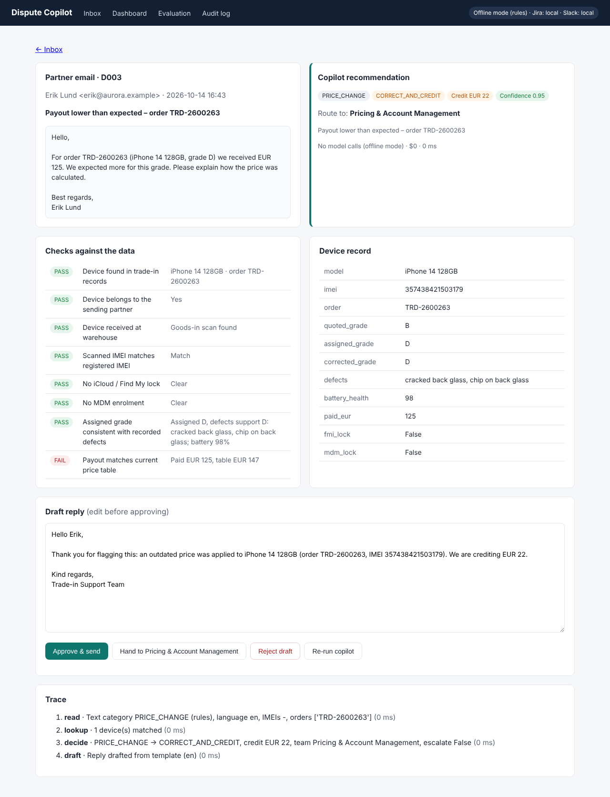

# Dispute Copilot — trade-in grade & payout disputes

A working prototype of an AI copilot for a phone recommerce business. Partners (mobile operators and retailers) email disputes about grades, payouts, locked or missing devices. The copilot reads each email, checks the device record, recommends a decision, drafts the reply and routes the case. **A person approves before anything is sent.**

All data is synthetic: invented partners, IMEIs, prices and emails. This is my own prototype for a recommerce scenario, not a tool of any company.



## Run it (Windows, macOS, Linux)

Needs Python 3.10 or newer. No packages to install.

```
python run.py
```

Your browser opens http://localhost:8501 automatically. On Windows you can also double-click `start_windows.bat`.
**Keep the black terminal window open** while you use the app; closing it stops the app.

### If the page does not load

| What you see | Fix |
|---|---|
| The window says "Python was not found" or the Microsoft Store opens | Install Python 3.10+ from python.org and tick **"Add python.exe to PATH"**, then run again |
| "Port 8501 is already in use" | Another copy is running; close that window, or set `"PORT": 8502` in `config.json` |
| Browser shows "can't reach this page" | Check the terminal window is still open and shows "Dispute Copilot is running"; refresh the page |
| Window opens and closes immediately | Open Command Prompt in the folder and run `py run.py` to see the error message |

| Command | What it does |
|---|---|
| `python run.py` | Start the web app |
| `python run.py --eval` | Score the copilot on all 39 labelled disputes in the terminal |
| `python run.py --reset` | Regenerate the synthetic data and clear the outbox |

## What it does

```
partner email ─► 1 READ ─► 2 FIND DEVICE ─► 3 VERIFY ─► 4 DECIDE ─► 5 DRAFT ─► person approves ─► reply + Jira ticket + Slack
                 (Claude or      (IMEI /         (checks vs      (rules +       (Claude or
                  rules)          order no.)      device data)    escalation)    template)
```

1. **Read** – category (grade, price, lock, IMEI mismatch, missing device), language, claimed grade. Uses Claude when an API key is set, otherwise keyword rules.
2. **Find device** – by IMEI and/or order number; IMEI checksum validated. If the device belongs to another partner, the copilot will not act on it.
3. **Verify** – goods-in scan, scanned vs registered IMEI, iCloud/Find My lock, MDM enrolment, grade vs recorded defects and battery, payout vs current price table.
4. **Decide** – `UPHOLD`, `CORRECT_AND_CREDIT` (with the exact credit), `REQUEST_INFO`, `INVESTIGATE` or `MANUAL_REVIEW`; routes to the owning team; escalates on value, repeat partner, escalation language or low confidence.
5. **Draft** – reply in the partner's language, using only verified facts.

**Design choice:** the model reads and writes; the decision is made by deterministic checks against the data. The model can never invent a grade or a credit amount, every decision is explainable, and it can be tested.

## Screens

- **Inbox** – run the copilot on one or all disputes.
- **Case** – email, recommendation, confidence, every check (pass/fail), device record, editable draft, Approve / Hand to team / Reject, and a timed trace.
- **Dashboard** – cases, review time, approved without edits, credits, escalations, cost per case, root causes by partner, device model and grader.
- **Evaluation** – runs all 39 labelled cases and scores category, action, credit, team, escalation and reply language.
- **Audit log** – every copilot run and every human decision.

## Connect Claude, Jira and Slack (optional)

Copy `config.example.json` to `config.json` and fill in what you want (or set the same names as environment variables).

| Setting | Effect |
|---|---|
| `ANTHROPIC_API_KEY`, `CLAUDE_MODEL` | Claude reads emails and drafts replies (any language). Without it: offline rules mode. |
| `PRICE_IN_PER_MTOK`, `PRICE_OUT_PER_MTOK` | USD per million tokens for the cost-per-case counter; set to your model's list price. |
| `JIRA_BASE_URL`, `JIRA_EMAIL`, `JIRA_API_TOKEN`, `JIRA_PROJECT_KEY` | Approved cases create a real Jira issue. Without it: written to `data/outbox/jira`. |
| `SLACK_WEBHOOK_URL` | Escalations and decisions post to Slack. Without it: written to `data/outbox/slack`. |

Replies are never emailed; they are written to `data/outbox/email`.

## Honest notes

- **Offline rules mode scores ~97% on the labelled set because the rules were written for these synthetic emails.** Real partner emails are messier; that is where Claude is needed and why the evaluation screen exists. The one rules miss is a Finnish email: the rules reply in English, Claude replies in Finnish.
- Price table, grade scale and defect rules are illustrative. In production they would come from the pricing engine and grading standard.
- Before production: real data access with least privilege, GDPR review (no consumer personal data in prompts), prompt-injection guardrails, monitoring, and a pilot with one team measuring baseline handling time, credits and rework.

## Project layout

```
run.py                  entry point
copilot/rules.py        grades, price table, defect rules, routing, escalation policy
copilot/data_gen.py     synthetic partners, devices, 39 labelled disputes (seeded)
copilot/agent.py        the pipeline: read → find → verify → decide → draft
copilot/llm.py          Claude Messages API client (standard library)
copilot/integrations.py Jira, Slack, outbox
copilot/store.py        SQLite, case lifecycle, metrics, evaluation
copilot/web.py          local web app
```
